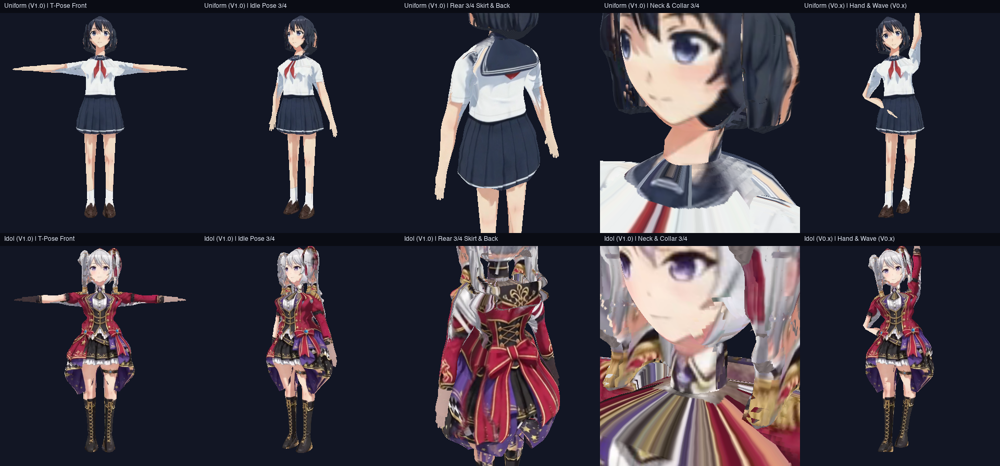

# Video → VRM Studio（日本語版 README）

**Zero-ML ターンテーブル動画 → VRM 1.0 / VRM 0.x 自動生成＆ブラウザスタジオ**

**ブラウザですぐ試せます: https://harukaappscreate.github.io/video-to-vrm-studio/**

[English README](./README.md) · [AI動画生成用プロンプト (`docs/PROMPTS.md`)](./docs/PROMPTS.md)

Video → VRM Studio は、クロマキー背景の 360° キャラクター回転動画（MP4）から、**ニューラルネット・GPU推論・外部APIを一切使わず**に 23ボーン＆13表情モーフ付きの **`.vrm`（VRM 1.0 / VRM 0.x）** を自動生成・プレビュー・書き出しできるツールです。Python CLI とブラウザ完結版（HTML5 Canvas + WebGL2）の両方を同梱しています。



---

## 主な特徴

* **Zero-ML・完全ローカル動作**: Python（`numpy` / `Pillow` / `ffmpeg`）およびブラウザ標準 WebGL2 のみで完結し、動画やモデルは外部へ一切送信されません。
* **骨格ロック・極座標ロフト構成**:
  * **鎖骨・顎実測ロック**: 正面シルエットの肩広がりと側面の顎ステップから首長を解剖学的レンジ（`4.2〜7.2cm`）に自動固定し、首の伸びすぎやシャツの誤投影を防止。
  * **可変裾・連続極座標ロフト胴体**: 首元から胸・腰・スカート裾ライン $y_{\text{hem}}(\phi)$ までを `64` 角度 × `52` リング＋折り返し裏地で 1 枚の連続メッシュとして構築。
  * **色基準の裾追跡＆腰のふた**: 素肌の色を判定してスカートの面に脚の肌色が混ざらないようにし、腰の部分は穴が開かないように無地の暗い色のふたで閉じます。
  * **凸構造アニメ顔・5本指ハンド**: 13種類の表情モーフ（`aa`, `ih`, `ou`, `ee`, `oh`, `blink`, `blinkLeft`, `blinkRight`, `happy`, `angry`, `sad`, `relaxed`, `surprised`）と手首シームレスな5本指ロフトを生成。
  * **肩上面の縦方向インペイント**: 上向き面（`n_y > 0.62`）の肩は真下のブラウス／袖色から縦方向に補間し、リボン色が肩に滲む現象を防止。
* **VRM 1.0 / VRM 0.x 準拠**: 23 ヒューマノイドボーン、MToon 1.0 / VRM 0.x / Unlit、表情、FirstPerson 設定、サムネイル付き。`gltf-validator`（VRM 1.0 はエラー 0・警告 0、VRM 0.x はエラー 0・警告 1。警告は `VRM` 拡張名についてのいつものもの）と `@pixiv/three-vrm` で確認しています。

---

## クイックスタート

### 方法 1: ブラウザ版スタジオ（インストール不要）

静的サーバで `web/` を配信してブラウザで開きます（GitHub Pages そのまま配信可能）：

```bash
python3 -m http.server 8000 --directory web
# ブラウザで http://localhost:8000 を開く
```

同梱サンプル（**制服サンプル** / **アイドル**）またはご自身の MP4 をドロップし、「VRMモデルを生成」を押し、「作者名」に自分の名前を入れて `.VRM 1.0` / `.VRM 0.x` で保存します。

### 方法 2: Python CLI

**前提**: Python 3.9+、`ffmpeg` / `ffprobe` が `PATH` に通っていること。

```bash
pip install -r requirements.txt

# VRM 1.0 と 0.x の両方＋1024x1024 UV画像を出力
python3 video_to_vrm.py web/sample_uniform.mp4 -o exports/avatar.vrm --vrm-version both --save-uv-dir exports/uvs
```

主なオプション:
* `--vrm-version {1.0,0.x,both}`（既定: `1.0`）
* `--shader {mtoon,unlit}`（既定: `mtoon`）
* `--pose {auto,tpose,apose}`（既定: `auto`）
* `--key-threshold FLOAT`（既定: `24.0`）
* `--name STR` / `--author STR`（`--author` には自分の名前を。既定: `Unknown`）
* `--save-uv-dir DIR`（`head/torso/body/hair` UV PNG の保存先）

---

## テスト実行

```bash
python3 -m unittest discover -s tests -v
```

---

## できる VRM について

* **作者**: 入力した名前（空欄なら `Unknown`）。ツールの作者の名前は入りません。
* **VRM に書き込む利用条件**: だれでもアバターとして使える、個人の非営利のみ、クレジット表記が必要、再配布と改変は可、過度な暴力・性的な表現は不可（VRM 1.0）。VRM 0.x は項目が少ないので `CC_BY_NC` になります。別の条件にしたいときは、UniVRM などの VRM 編集ツールで変えてください。
* **入力する動画**: 自分で作ったもの、または使ってよいものだけを使ってください。実在の人を本人の同意なくアバターにしたり、他人のキャラクターをアバターにしたりしないでください。

## サンプル動画

`web/sample_uniform.mp4` と `web/sample_idol.mp4`（およびそれから作った `docs/` の画像）は、作者がこのツールのために Google Gemini で生成したものです。キャラクターはこのツール用に AI で生成したデザインです。

---

## ライセンス

MIT License © 2026 [haruka_apps](./LICENSE)（コード）。このツールと、ツールで作ったものは「現状のまま」提供され、いかなる保証もありません。
