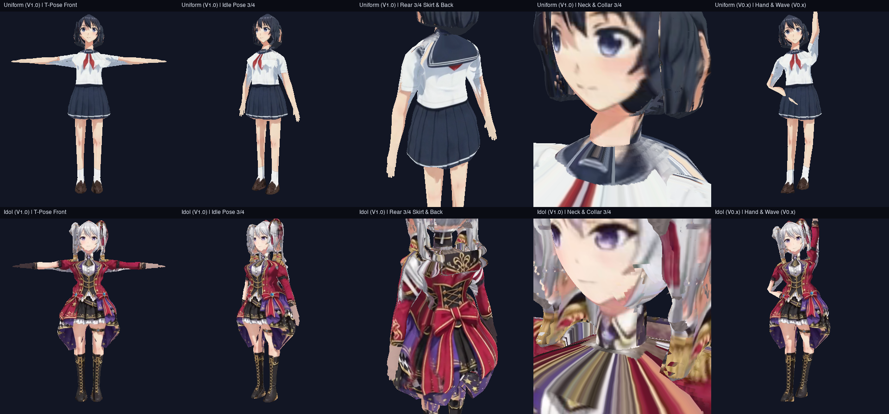
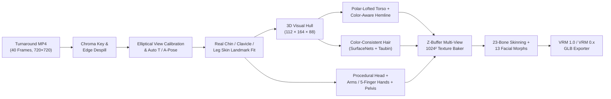
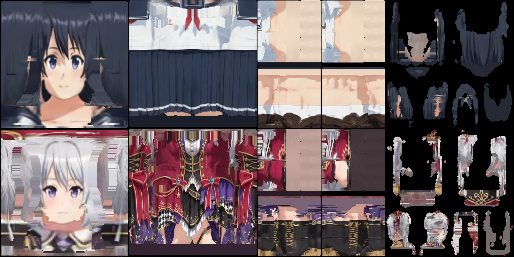

# Video → VRM Studio

**Zero-ML Turntable Video → Spec-Compliant VRM 1.0 / VRM 0.x Converter & Browser Studio**

**Try it in your browser: https://harukaappscreate.github.io/video-to-vrm-studio/**

[日本語版 README (README.ja.md)](./README.ja.md) · [AI Turntable Prompts (`docs/PROMPTS.md`)](./docs/PROMPTS.md)

Video → VRM Studio converts a short chroma-keyed 360° character turnaround MP4 video directly into a rigged, expression-ready `.vrm` avatar (**VRM 1.0** and **VRM 0.x**) **without any neural networks, GPU inference, or cloud APIs** — running both in Python CLI and 100% client-side in a standard browser via HTML5 Canvas + WebGL2.



---

## Key Features

- **Zero-ML, 100% Local**: Built purely with classical computer vision, geometry, and computational graphics (`numpy` + `Pillow` + `ffmpeg` for CLI; pure JavaScript + WebGL2 in browser).
- **Anatomical-Lock Hybrid Geometry**:
  - **Real Clavicle & Chin Detection**: Measures front silhouette shoulder onset and side-profile chin depth to lock anatomical neck proportions (`4.2–7.2 cm`) instead of fixed body ratios.
  - **Continuous Polar-Lofted Torso & Skirt**: Lofts `64` radial angles × `52` height rings (+ tucked inner skirt lining) with a variable hemline $y_{\text{hem}}(\phi)$ — supporting pleated skirts, uniform hems, and asymmetrical coats cleanly.
  - **Color-Aware Hemline & Closed Hip Cap**: Keeps bare-leg skin colour out of the skirt surface while tracking the hemline, and closes the mesh at the hips with a plain dark cap so the model has no holes.
  - **Procedural Convex Head & 5-Finger Hands**: Generates a convex anime head with 13 standard facial morph targets (`aa`, `ih`, `ou`, `ee`, `oh`, `blink`, `blinkLeft`, `blinkRight`, `happy`, `angry`, `sad`, `relaxed`, `surprised`) and seamless `Arm → Wrist → Palm → 5 Fingers` lofting.
  - **Directional Shoulder Baking Guard**: Prevents grazing side cameras from smearing collar ribbons across upward-facing shoulder texels (`n_y > 0.62`), filling downward in UV space from the vertical wall underneath.
- **VRM 1.0 & VRM 0.x Compliant**:
  - Complete **23 humanoid bones**, **MToon 1.0** (`VRMC_materials_mtoon`) / **VRM 0.x** (`VRM/MToon`) / `KHR_materials_unlit`, **13 expressions**, `firstPerson` annotations, and `thumbnailImage`.
  - Validated with `gltf-validator` (VRM 1.0: 0 errors, 0 warnings; VRM 0.x: 0 errors, 1 warning, the usual one about the `VRM` extension name) and `@pixiv/three-vrm@3.3.3`.

---

## Architecture Pipeline





---

## Quick Start

### Option 1: Browser Studio (Zero Install)

Serve the `web/` folder with any static HTTP server and open it in Chrome, Edge, or Safari:

```bash
python3 -m http.server 8000 --directory web
# Open http://localhost:8000 in your browser
```

Click one of the bundled sample buttons (**School Uniform**, **Idol Dress**) or drag-and-drop your own chroma-keyed turntable MP4, click **Generate VRM**, inspect poses/expressions/UVs in WebGL2, enter your name in **Author**, and download `.VRM 1.0` or `.VRM 0.x`.

### Option 2: Python CLI

**Prerequisites**: Python 3.9+, `ffmpeg` (and `ffprobe`) on `PATH`.

```bash
pip install -r requirements.txt

# Export both VRM 1.0 and VRM 0.x + 1024x1024 UV textures
python3 video_to_vrm.py web/sample_uniform.mp4 -o exports/avatar.vrm --vrm-version both --save-uv-dir exports/uvs
```

CLI options:
- `--vrm-version {1.0,0.x,both}` (default: `1.0`)
- `--shader {mtoon,unlit}` (default: `mtoon`)
- `--pose {auto,tpose,apose}` (default: `auto`)
- `--key-threshold FLOAT` (default: `24.0`)
- `--name STR` / `--author STR` (put your own name in `--author`; default: `Unknown`)
- `--save-uv-dir DIR` (optional directory to save `head/torso/body/hair` PNG atlases)

---

## Running Tests

```bash
python3 -m unittest discover -s tests -v
```

---

## Preparing Your Own Input Video

Because this tool is **Zero-ML**, input video consistency matters. See [docs/PROMPTS.md](docs/PROMPTS.md) for copy-paste turnaround generation prompts (tuned for Gemini / Veo) and a 4-point quality checklist.

---

## Known Limitations (Zero-ML Trade-offs)

- Expects a mostly rigid character rotating 360° against a uniform **green (`#00FF00`) chroma-key background** (avoid green clothing/eyes).
- **One full turn at a roughly constant speed.** The video must start facing the camera and turn exactly once over the whole clip. The tool finds the side and back views from the silhouette width and spreads the angles evenly between them, so a turn that speeds up, stops, or goes past 360° gives a broken shape.
- **Tested range is narrow.** Tested only with slim anime-style figures in skirts (the two samples and one more like them). Trousers, broad or male body shapes, and long hair covering the back or shoulders have not been tested yet and may not work well. The head shape is built procedurally (only its colours come from the video), so head shapes look alike between characters.
- Surfaces completely hidden from horizontal/shallow cameras (e.g., underside of thick ponytails, inner hollow lining) are synthesized using darkened local shading and anatomically closed base caps.
- Heavily baggy robes spanning below the knees or overlapping crossed legs cannot be separated solely from silhouette cues.

---

## The VRM You Get

- **Author**: the name you enter (`Unknown` if left empty). The tool never writes its own name into your avatar.
- **Conditions of use written into the VRM**: anyone may use it as an avatar, personal non-commercial use only, credit required, redistribution and modification allowed, no excessive violence or sexual content (VRM 1.0). VRM 0.x has fewer fields, so it becomes `CC_BY_NC`. Change them in a VRM editor (for example UniVRM) if you want other terms.
- **Your input video**: use only videos you made or are allowed to use. Do not make avatars of real people without their consent, or of characters that belong to someone else.

## Sample Videos

`web/sample_uniform.mp4` and `web/sample_idol.mp4` (and the images in `docs/`, which are made from them) were generated by the author with Google Gemini for this tool. The characters are AI-generated designs made for this tool.

---

## License

MIT License © 2026 [haruka_apps](./LICENSE) (the code). The tool and everything it makes are provided "AS IS", without warranty of any kind.
